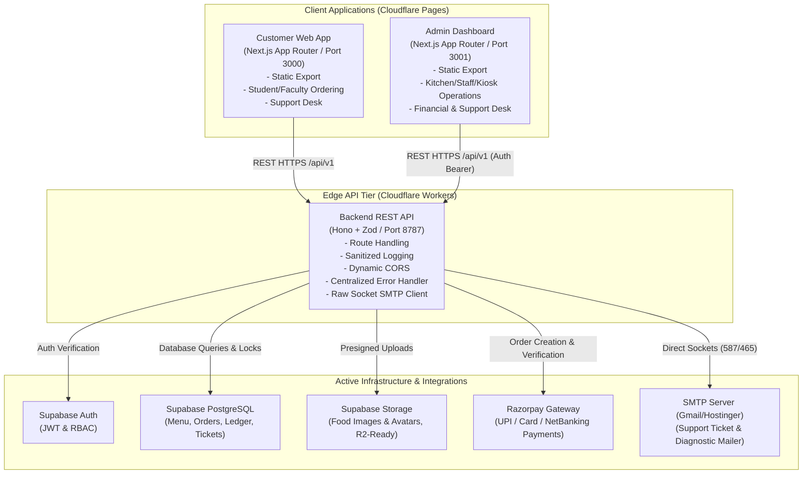

# Cafteria Architecture & Technical Specification

> **Phase 5.1: Production Hardened (Payments, Roles, Support Desk & Mailer Active)**
>
> Cafteria is a modern, full-stack digital canteen ordering and management platform tailored for college campuses. For authentication details, see [docs/authentication.md](authentication.md).

---

## 1. System Overview

Cafteria decouples frontend experiences from backend business logic by maintaining three completely independent applications within a single repository structure:

```
college-canteen-cev/
├── customer/     # Customer-facing static Next.js web application (Port 3000)
├── admin/        # Management & kitchen operations Next.js dashboard (Port 3001)
├── backend/      # Dedicated REST API powered by Hono on Cloudflare Workers (Port 8787)
└── docs/         # System architecture and implementation documentation
```

### Key Architectural Tenets
1. **Zero Monorepo Clutter:** No workspace frameworks (Turborepo, Nx, Lerna, npm/yarn/pnpm workspaces) to avoid configuration drift and leaky dependencies. Each application has isolated dependencies and its own `package.json` and `tsconfig.json`.
2. **Strict Separation of Concerns:** Neither frontend implements business logic or Next.js server-side API routes (`/api/*`). All reads, writes, transactions, and privileged actions route exclusively through the backend API.
3. **Edge Performance & Static Export:** Both frontends are pre-compiled into static HTML/CSS/JS (`output: 'export'`) optimized for deployment onto **Cloudflare Pages**. Dynamic execution happens on **Cloudflare Workers**.
4. **Environment Isolation:** Backend endpoints are dynamically injected through environment variables (`NEXT_PUBLIC_API_URL`), enabling trivial switching between local development, staging, and production.

---

## 2. High-Level Architecture Diagram



---

## 3. Application Responsibilities

### 3.1 Customer Application (`customer/`)
* **Role:** Student and faculty public interface for discovering food, scheduling pre-orders, and checking out.
* **Technology:** Next.js (App Router), TypeScript (strict mode), Tailwind CSS, Lucide React.
* **Hosting Target:** Cloudflare Pages (Static Export via `output: 'export'`).
* **Port (Dev):** `http://localhost:3000`
* **Responsibilities:**
  - Responsive, mobile-first ordering UI.
  - Live menu browsing with category filtering and real-time availability badges (Upcoming).
  - Cart state and scheduled pickup interval selection (Upcoming).
  - Razorpay payment initiation and student order tracking (Upcoming).
  - Direct consumption of backend endpoints via `fetch()` using `NEXT_PUBLIC_API_URL`.

### 3.2 Admin Application (`admin/`)
* **Role:** Back-office portal for canteen management, kitchen operators, cashier counters, stockkeepers, and hardware kiosks.
* **Technology:** Next.js (App Router), TypeScript (strict mode), Tailwind CSS, Lucide React.
* **Hosting Target:** Cloudflare Pages (Static Export via `output: 'export'`).
* **Port (Dev):** `http://localhost:3001`
* **Roles Supported (`app_role`):**
  - `developer`: Superadmin authority with diagnostic logs and user role assignment tools (`/developer`).
  - `admin`: Full operations authority over orders, menu dishes, categories, inventory, teacher verification, and reports.
  - `staff`: Kitchen/store floor worker authority. Can scan QR pickup tokens, accept checkouts, update portion stocks, and add new dish stocks (`/orders`, `/scan`, `/inventory`, `/menu`).
  - `retail`: Inventory portion manager ONLY. Can adjust portion stock quantities and low-stock cut-offs (`/inventory`).
  - `printer`: Hardware terminal kiosk role with barcode/QR scanner and thermal receipt bill printer (`/printer`). Scans pickup QR codes, executes `/collect-qr`, and generates thermal bills via `/:id/receipt`.
* **Responsibilities:**
  - Secure operational dashboards mapped by specific role permissions.
  - Real-time Kitchen Display System (KDS) order dispatch queue (`/orders`).
  - Menu catalog management and category controls (`/menu`, `/categories`).
  - Inventory portion adjustments and stock logging (`/inventory`).
  - Hardware bill printing terminal interface (`/printer`).
  - Zero privileged business logic in client code; all state transitions are authorized and executed by the backend.

### 3.3 Backend API (`backend/`)
* **Role:** The single source of truth for all data access, validation, business rules, and external integrations.
* **Technology:** Hono framework, TypeScript (strict mode), Cloudflare Workers, Wrangler, Zod.
* **Hosting Target:** Cloudflare Workers (Global Edge Network).
* **Port (Dev):** `http://localhost:8787`
* **Responsibilities:**
  - High-performance, edge-rendered RESTful API under `/api/v1`.
  - Strict input validation using Zod schemas (`@hono/zod-validator`).
  - Dynamic CORS header injection matching configured client origins.
  - Centralized error handling returning structured JSON errors.
  - Sanitized request logging (redacting sensitive authorization headers, tokens, and cookies).
  - Health checks (`GET /health`) executable with zero external credentials.

---

## 4. Communication & Networking

### Protocols & Data Formats
* **Format:** All API payloads and responses are standardized JSON.
* **Base Path:** Business logic endpoints reside under `/api/v1`.
* **Root Health Check:** `GET /health` returns operational health metrics without requiring database connectivity:
  ```json
  {
    "status": "healthy",
    "timestamp": "2026-10-19T18:00:00.000Z",
    "service": "cafteria-backend",
    "version": "1.0.0",
    "environment": "development"
  }
  ```
* **API Metadata:** `GET /api/v1` returns API versioning and directory information:
  ```json
  {
    "name": "Cafteria REST API",
    "version": "1.0.0",
    "status": "active",
    "phase": "Phase 1 - Project Foundation",
    "endpoints": {
      "health": "/health",
      "apiV1": "/api/v1"
    }
  }
  ```

### Cross-Origin Resource Sharing (CORS)
The backend reads the `ALLOWED_ORIGINS` environment variable (comma-separated):
```ini
ALLOWED_ORIGINS=http://localhost:3000,http://localhost:3001
```
In incoming requests, Hono matches the `Origin` header against the allowlist and responds with corresponding `Access-Control-Allow-Origin`, `Access-Control-Allow-Methods`, and `Access-Control-Allow-Headers`.

---

## 5. Environment Variables & Secret Management

All environment variables follow strict 12-factor principles. Never commit secrets, service keys, or database credentials to version control.

### Templates Summary
| Application | Template File | Local Development Target | Description |
|---|---|---|---|
| `customer/` | `.env.example` | `.env.local` | Public API URL (`NEXT_PUBLIC_API_URL`) |
| `admin/` | `.env.example` | `.env.local` | Public API URL (`NEXT_PUBLIC_API_URL`) |
| `backend/` | `.dev.vars.example` | `.dev.vars` | Cloudflare Workers local environment bindings |

### Sample Environment Declarations

#### Frontends (`customer/.env.example` & `admin/.env.example`)
```ini
# Base URL of the dedicated backend REST API
NEXT_PUBLIC_API_URL=http://localhost:8787
```

#### Backend (`backend/.dev.vars.example`)
```ini
ENVIRONMENT=development
ALLOWED_ORIGINS=http://localhost:3000,http://localhost:3001

# Upcoming Phase Integrations
# SUPABASE_URL=https://your-project-id.supabase.co
# SUPABASE_ANON_KEY=your-anon-key
# SUPABASE_SERVICE_ROLE_KEY=your-service-role-key
# RAZORPAY_KEY_ID=rzp_test_placeholder
# RAZORPAY_KEY_SECRET=placeholder_secret
```

---

## 6. Deployment Assumptions

### Static Frontends (Cloudflare Pages)
* Built using `next build` with `output: 'export'` configured in `next.config.mjs`.
* Output artifacts reside in the respective `out/` folder.
* Hosted as static assets on Cloudflare's global CDN with zero server-side Node.js runtime overhead.
* Route navigation handled via client-side routing with clean HTML fallbacks.

### Dedicated Backend (Cloudflare Workers)
* Deployed via Wrangler CLI (`wrangler deploy`).
* Compliant with standard Cloudflare Worker V8 runtime (`compatibility_flags = ["nodejs_compat"]`).
* Production secrets configured using `wrangler secret put <KEY>`.

---

## 7. Security Constraints & Phased Roadmap

### Completed Phases
* [x] **Phase 1: Project Foundation**
  - Three independent applications with distinct dependency trees.
  - Static exports enabled for both frontends.
  - Port bindings isolated (`3000`, `3001`, `8787`).
  - Sanitized logger preventing credential and cookie leakage in logs.
  - CORS protection with dynamic origin evaluation.
  - Health check operational without third-party services.
* [x] **Phase 2: Authentication & RBAC (Supabase Auth & RLS)**
  - Supabase Auth integration for Customer and Admin frontends.
  - `public.profiles` schema with check constraints and triggers.
  - Row Level Security (RLS) preventing privilege escalation.
  - Hono Bearer token verification middleware (`requireAuth`) & admin middleware (`requireAdmin`).
* [x] **Phase 3: Database Models & Catalog Management**
  - Schema migrations for menu items, categories, integer paise pricing, and 86 availability toggles.
  - Temporary Supabase Storage integration with Cloudflare R2 compatibility.
* [x] **Phase 4: Order Lifecycle & Kitchen Display System**
  - Shopping cart persistence, kitchen display dispatch queue, inventory tracking with low-stock alerts.
* [x] **Phase 5: Production Payment Integration, 5-Tier Roles & Excel Reports**
  - Razorpay Standard Checkout in integer paise, Web Crypto HMAC SHA-256 webhook deduplication (`payment_webhook_events`).
  - 5-tier role authority (`developer`, `admin`, `staff`, `retail`, `printer`).
  - Developer Console (`/developer`), Google OAuth, circular profile avatars, 3-column Excel report exports (`/api/v1/admin/reports/export`).
* [x] **Phase 5.1: Production Hardening, Support Desk & Infrastructure Maturation**
  - Campus support ticket system (`/support`) with auto-generated ticket numbers and admin email reply alerts.
  - Raw socket SMTP mail client (ports 587/465, STARTTLS/TLS, Cloudflare Workers `node:tls` compatibility, RFC 5321 envelope sanitization).
  - Atomic stock reservation locks (`cart_item_locks`) with non-deducting concurrency logic.
  - 10:00 PM IST daily QR service cutoff.
  - Permanent purge of legacy wallet and cancellation schemas from database and codebases.

### Upcoming Phases
* **Phase 6: Advanced Analytics & Predictive Inventory**
  - Rush hour traffic heatmaps, predictive stock forecasting, and automated re-ordering triggers.
