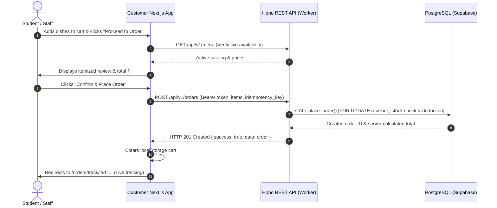

# Cart & Checkout Specification — Cafteria Platform

> **Status:** Phase 4 Live  
> **Scope:** Client-Side Cart Persistence, Server-Side Authoritative Pricing, and Checkout Experience.

---

## 1. Client-Side Cart Persistence

The shopping cart is managed via `customer/src/context/CartContext.tsx` and persisted in browser `localStorage` under `cafteria_customer_cart`.

### Cart Item Shape:
```typescript
export interface CartItem {
  id: string;             // Menu Item UUID
  name: string;           // Display Name
  price: number;          // Price in paise
  image_url: string | null;
  category_name?: string;
  quantity: number;       // Integer 1–50
}
```

### Safety Controls:
- **Quantity Caps:** Minimum 1, maximum 50 per individual dish to prevent accidental overflow.
- **Availability Guard:** Adding items to the cart is only permitted for dishes with `is_available = true`.
- **Dynamic Updates:** Modifying quantities to `0` removes the item from the cart.
- **Sticky Floating Bar:** When `itemCount > 0`, a mobile-optimized floating bar at the bottom of the screen displays total items, rupee amount, and a direct link to `/cart`.

---

## 2. Server-Authoritative Price & Inventory Validation

The client-side cart is never treated as a trusted boundary:
1. When the customer proceeds to `/checkout`, the page fetches the latest catalog from `GET /api/v1/menu`.
2. Any items that have been disabled, 86'd, or archived since being added to the cart are highlighted with warnings.
3. Upon submitting `POST /api/v1/orders`:
   - The payload sends **only** `menu_item_id` and `quantity`.
   - The server completely ignores client prices and subtotals.
   - The server queries `public.menu_items`, verifies `is_available = true`, checks stock, and computes line totals and grand totals using server integer prices in paise.

---

## 3. Order Placement Flow



---

## 4. Phase 4 vs Phase 5 Payment Boundary

| Feature | Phase 4 (Current) | Phase 5 (Upcoming) |
|---|---|---|
| Order Status | `pending` immediately queued | `pending` awaiting checkout |
| Payment Status | `unpaid` | `unpaid` -> `paid` via Razorpay |
| Gateways | None (Zero real payment claims) | Razorpay Orders API & Checkout Modal |
| Webhooks | None | Razorpay Signature Verification Webhook |
| Fulfillment Trigger | Immediately upon order creation | Triggered upon cryptographic webhook confirmation |
