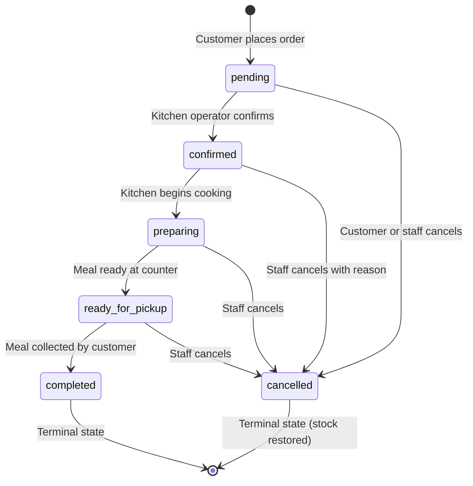

# Orders Subsystem Specification — Cafteria Platform

> **Status:** Phase 4 Live  
> **Scope:** Order Placement, State Machine Transitions, Concurrency Control & Idempotency.

---

## 1. Architectural Overview

The Orders subsystem coordinates customer cart checkouts with kitchen dispatch and inventory control. The backend REST API running on Cloudflare Workers acts as the authoritative boundary for pricing, order creation, and status validation. PostgreSQL Row-Level Security (RLS) ensures customers only access their own order records, while verified canteen administrators have operational oversight across the entire campus queue.

---

## 2. Database Schema

### 2.1 `public.orders` Table
Stores header-level order records, customer references, timestamps, and payment/fulfillment statuses.

| Column | Type | Constraints | Description |
|---|---|---|---|
| `id` | `uuid` | `PRIMARY KEY DEFAULT gen_random_uuid()` | Internal collision-resistant UUID |
| `customer_id` | `uuid` | `NOT NULL REFERENCES auth.users(id) ON DELETE CASCADE` | Ordering customer ID |
| `order_number` | `text` | `NOT NULL UNIQUE` | Human-readable token e.g. `CAF-YYMMDD-XXXX` |
| `order_status` | `text` | `NOT NULL DEFAULT 'pending' CHECK (...)` | Lifecycle fulfillment state |
| `payment_status` | `text` | `NOT NULL DEFAULT 'unpaid' CHECK (...)` | Monetary settlement state |
| `subtotal` | `integer` | `NOT NULL CHECK (subtotal >= 0)` | Subtotal in integer paise |
| `total` | `integer` | `NOT NULL CHECK (total >= 0)` | Final payable in integer paise |
| `idempotency_key` | `text` | `NULLABLE` | Scoped submission deduplication key |
| `cancellation_reason` | `text` | `NULLABLE` | Reason logged upon cancellation |
| `cancelled_at` | `timestamptz` | `NULLABLE` | Cancellation timestamp |
| `cancelled_by` | `uuid` | `REFERENCES auth.users(id)` | User who executed cancellation |
| `confirmed_at` | `timestamptz` | `NULLABLE` | Kitchen acceptance timestamp |
| `preparing_at` | `timestamptz` | `NULLABLE` | Cooking progression timestamp |
| `ready_at` | `timestamptz` | `NULLABLE` | Ready-for-pickup timestamp |
| `completed_at` | `timestamptz` | `NULLABLE` | Customer handoff timestamp |
| `created_at` | `timestamptz` | `NOT NULL DEFAULT now()` | Initial creation timestamp |
| `updated_at` | `timestamptz` | `NOT NULL DEFAULT now()` | Last update timestamp |

**Constraint:** `UNIQUE (customer_id, idempotency_key)` guarantees that identical keys per customer cannot duplicate orders.

### 2.2 `public.order_items` Table
Preserves immutable line-item price and name snapshots at the moment of order placement.

| Column | Type | Constraints | Description |
|---|---|---|---|
| `id` | `uuid` | `PRIMARY KEY DEFAULT gen_random_uuid()` | Unique line item identifier |
| `order_id` | `uuid` | `NOT NULL REFERENCES public.orders(id) ON DELETE CASCADE` | Associated order |
| `menu_item_id` | `uuid` | `REFERENCES public.menu_items(id) ON DELETE SET NULL` | Reference to catalog dish |
| `item_name` | `text` | `NOT NULL` | Historical name snapshot |
| `unit_price` | `integer` | `NOT NULL CHECK (unit_price >= 0)` | Unit price in paise at purchase |
| `quantity` | `integer` | `NOT NULL CHECK (quantity > 0)` | Quantity ordered (1–50) |
| `line_total` | `integer` | `NOT NULL CHECK (line_total >= 0)` | Line total in paise (`unit_price * quantity`) |
| `created_at` | `timestamptz` | `NOT NULL DEFAULT now()` | Creation timestamp |

---

## 3. Order Lifecycle State Machine

Orders follow strict, non-reversible state transitions:

### Transition Permissions:
- `pending -> confirmed`: Verified Administrators only.
- `confirmed -> preparing`: Verified Administrators only.
- `preparing -> ready_for_pickup`: Verified Administrators only.
- `ready_for_pickup -> completed`: Verified Administrators only.
- `pending -> cancelled`: Allowed by ordering customer OR administrator.
- `confirmed -> cancelled`: Allowed by ordering customer OR administrator.
- `preparing / ready_for_pickup -> cancelled`: Allowed exclusively by administrator.
- `completed -> any`: FORBIDDEN. Terminal state.
- `cancelled -> any`: FORBIDDEN. Terminal state.

---

## 4. Concurrency & Stock Locks

To prevent race conditions and overselling during college lunch rushes:
1. When `public.place_order(...)` executes, it locks requested menu item rows using `SELECT ... FROM public.menu_items WHERE id IN (...) FOR UPDATE`.
2. Concurrent checkouts for the same menu items wait for the row lock to release before evaluating `stock_quantity`.
3. If remaining stock is less than requested quantity, the transaction raises `ERR_INSUFFICIENT_STOCK` and rolls back completely without writing partial orders.

---

## 5. Idempotency Key Strategy

1. The customer frontend generates a UUID idempotency key before submitting `POST /api/v1/orders`.
2. When the backend or `place_order` stored procedure detects an existing record with matching `(customer_id, idempotency_key)`:
   - The original order details are returned immediately with HTTP 200 OK and `is_idempotent_replay: true`.
   - No additional stock is deducted.
   - Network dropouts and accidental double-clicks do not create duplicate charges or kitchen tickets.

---

## 6. Payment Handoff to Phase 5

In Phase 4:
- All placed orders are assigned `payment_status = 'unpaid'`.
- Real online payment gateways (Razorpay, UPI webhooks) are deferred to Phase 5.
- Orders proceed directly into the preparation queue for on-campus testing.
