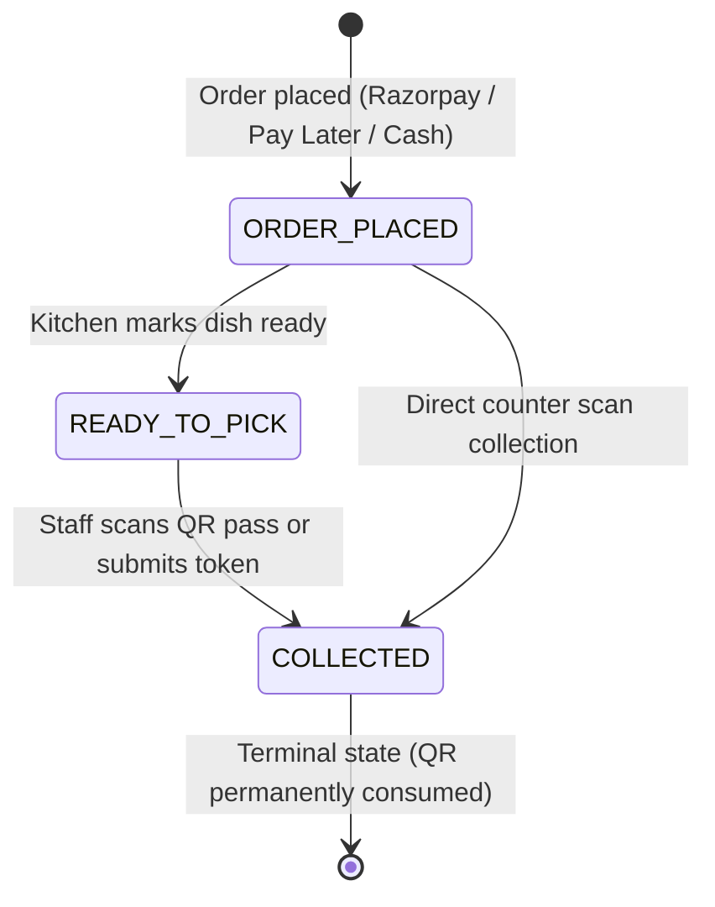

# Orders Subsystem Specification — Cafteria Platform

> **Status:** Phase 5.1 Live  
> **Scope:** Order Placement, Canonical State Transitions, Razorpay / Pay Later Settlement & Concurrency Control.

---

## 1. Architectural Overview

The Orders subsystem coordinates customer checkouts with kitchen dispatch, payment gateways, and inventory control. The backend REST API running on Cloudflare Workers acts as the authoritative boundary for pricing, order creation, payment verification, and status validation. PostgreSQL Row-Level Security (RLS) ensures customers only access their own order records, while verified canteen administrators have operational oversight across the entire campus queue.

---

## 2. Database Schema

### 2.1 `public.orders` Table
Stores header-level order records, customer references, timestamps, QR tokens, and payment/fulfillment statuses.

| Column | Type | Constraints | Description |
|---|---|---|---|
| `id` | `uuid` | `PRIMARY KEY DEFAULT gen_random_uuid()` | Internal collision-resistant UUID |
| `customer_id` | `uuid` | `NOT NULL REFERENCES auth.users(id) ON DELETE CASCADE` | Ordering customer ID |
| `order_number` | `text` | `NOT NULL UNIQUE` | Human-readable token e.g. `CAF-YYMMDD-XXXX` |
| `order_status` | `text` | `NOT NULL DEFAULT 'pending' CHECK (...)` | Lifecycle fulfillment state |
| `order_stage` | `text` | `NOT NULL DEFAULT 'ORDER_PLACED' CHECK (...)` | High-level 3-stage UI progression (`ORDER_PLACED`, `READY_TO_PICK`, `COLLECTED`) |
| `payment_status` | `text` | `NOT NULL DEFAULT 'unpaid' CHECK (...)` | Monetary settlement state (`'unpaid'`, `'paid'`) |
| `payment_method` | `text` | `NOT NULL DEFAULT 'razorpay' CHECK (...)` | Payment channel (`'razorpay'`, `'counter_cash'`, `'pay_later'`) |
| `razorpay_order_id` | `text` | `NULLABLE` | Gateway order ID generated by Razorpay API |
| `razorpay_payment_id` | `text` | `NULLABLE` | Gateway payment ID verified post-checkout |
| `subtotal` | `integer` | `NOT NULL CHECK (subtotal >= 0)` | Subtotal in integer paise |
| `total` | `integer` | `NOT NULL CHECK (total >= 0)` | Final payable in integer paise |
| `idempotency_key` | `text` | `NULLABLE` | Scoped submission deduplication key |
| `qr_verification_token` | `text` | `NOT NULL UNIQUE` | Unguessable verification token e.g. `CAF-QR-XXXXXX` |
| `qr_consumed_at` | `timestamptz` | `NULLABLE` | Counter collection timestamp expiring the token |
| `confirmed_at` | `timestamptz` | `NULLABLE` | Kitchen acceptance timestamp |
| `preparing_at` | `timestamptz` | `NULLABLE` | Cooking progression timestamp |
| `ready_at` | `timestamptz` | `NULLABLE` | Ready-for-pickup timestamp |
| `completed_at` | `timestamptz` | `NULLABLE` | Customer handoff timestamp |
| `created_at` | `timestamptz` | `NOT NULL DEFAULT now()` | Initial creation timestamp |
| `updated_at` | `timestamptz` | `NOT NULL DEFAULT now()` | Last update timestamp |

> [!NOTE]
> Order cancellation fields (`cancellation_reason`, `cancelled_at`, `cancelled_by`) and cancellation statuses were permanently purged in migration `0013_remove_order_cancellation.sql`.

### 2.2 `public.order_items` Table
Preserves immutable line-item price and name snapshots at the moment of order placement.

| Column | Type | Constraints | Description |
|---|---|---|---|
| `id` | `uuid` | `PRIMARY KEY DEFAULT gen_random_uuid()` | Unique line item identifier |
| `order_id` | `uuid` | `NOT NULL REFERENCES public.orders(id) ON DELETE CASCADE` | Associated order |
| `menu_item_id` | `uuid` | `REFERENCES public.menu_items(id) ON DELETE SET NULL` | Reference to catalog dish |
| `item_name` | `text` | `NOT NULL` | Historical name snapshot |
| `unit_price` | `integer` | `NOT NULL CHECK (unit_price >= 0)` | Unit price in paise at purchase |
| `quantity` | `integer` | `NOT NULL CHECK (quantity > 0)` | Quantity ordered (1–50) |
| `line_total` | `integer` | `NOT NULL CHECK (line_total >= 0)` | Line total in paise (`unit_price * quantity`) |
| `created_at` | `timestamptz` | `NOT NULL DEFAULT now()` | Creation timestamp |

---

## 3. Order Lifecycle State Machine & Zero Cancellation Policy

Orders follow strict, non-reversible state transitions. In line with campus canteen operational policy, once placed and paid, orders **cannot be cancelled or refunded**.

### Transition Guarantees:
- `ORDER_PLACED -> READY_TO_PICK`: Triggered by kitchen operators via `POST /api/v1/admin/orders/:id/ready`.
- `READY_TO_PICK -> COLLECTED`: Verified by scanning counter staff via `POST /api/v1/admin/orders/:id/collect`.
- `ORDER_PLACED -> COLLECTED`: Permitted directly via automated QR barcode submission (`POST /api/v1/admin/orders/collect-qr`).
- `COLLECTED -> any`: FORBIDDEN. Terminal fulfillment state. `qr_consumed_at` is set, invalidating subsequent pickup attempts.
- **Service Day Expiration:** Orders uncollected by 10:00 PM IST on the service day are automatically deemed expired by verification endpoints.

---

## 4. Concurrency & Stock Locks

To prevent race conditions and overselling during lunch peak rushes:
1. When items are added to the cart, the client calls `POST /api/v1/cart/lock` to acquire temporary atomic locks in `public.cart_item_locks` for 5 minutes.
2. During checkout (`POST /api/v1/orders`), the backend resolves the caller's active reservation locks by `user_id` and `x-session-id`, computing available stock as `Math.max(item.stock_quantity, item.stock_quantity + lockedByCaller)`.
3. Requested quantities are validated against true available stock. Physical stock in `menu_items` is decremented atomically upon confirmed order creation.

---

## 5. Idempotency Key Strategy

1. The customer frontend generates a unique UUID idempotency key before submitting `POST /api/v1/orders`.
2. When the backend detects an existing order with matching `(customer_id, idempotency_key)`:
   - The original order details are returned immediately with HTTP 200 OK.
   - No duplicate payment gateway orders or stock deductions occur.
