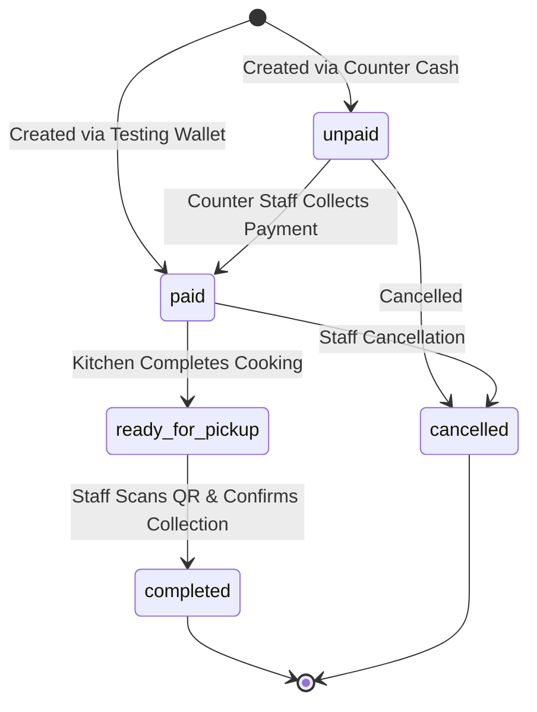

# Cafteria QR Order Verification & Bill Printing Architecture

---

## 1. Subsystem Overview

Phase 4.1 establishes cryptographic pickup verification and print-optimized billing for canteen meal dispatch:
1. **Opaque Verification Token**: Upon successful payment, an unguessable token (`CAF-QR-XXXXXX`) is generated and securely bound to the order record.
2. **Customer Pass Screen**: Customer displays a high-resolution SVG QR code and alphanumeric token on their phone at the pickup counter.
3. **Staff Scanner & Dispatch**: Canteen operators scan the QR pass via camera or enter the manual token code in `/scan` to verify order integrity, item completeness, and authorize meal collection.
4. **Printable Bills**: Print-optimized stylesheets (`@media print`) format full register receipts on 8.5x11 / A4 paper with high contrast and zero clipped items.

---

## 2. Order Lifecycle & Verification State Machine

### Verification Eligibility Rules:
An order is eligible for collection via `POST /api/v1/admin/orders/:id/collect` if and only if:
- `payment_status = 'paid'` (unpaid orders must be settled first).
- `order_status != 'completed'` (duplicate collections are rejected with `ERR_ALREADY_COLLECTED`).
- `order_status != 'cancelled'` (cancelled orders are rejected with `ERR_ORDER_CANCELLED`).

---

## 3. REST API Interface

### Admin Endpoints
- `POST /api/v1/admin/orders/verify-qr`:
  - Body: `{ qr_token: string }`.
  - Returns order metadata, items list, customer identity, and boolean `is_eligible_for_collection`.
- `POST /api/v1/admin/orders/:id/collect`:
  - Atomically marks order status as `completed`, recording `collected_at = now()` and `collected_by = operator_id`.
  - Rejects duplicate calls with `400 ALREADY_COLLECTED`.
- `GET /api/v1/admin/orders/:id/receipt`:
  - Returns itemized bill data snapshot for operations register.

### Customer Endpoints
- `GET /api/v1/orders/:id/receipt`:
  - Customer bill retrieval endpoint (restricted to owning customer and admin).

---

## 4. Print Layouts

Both customer and admin bill views implement CSS `@media print` rules:
- Interactive headers, footers, buttons, and navigation bars are hidden (`print:hidden`).
- Document margins, page breaks, and background colors are optimized for black-and-white / color thermal and laser printers.
- Itemized charges, token numbers, and pickup QR pass render with maximum legibility.
