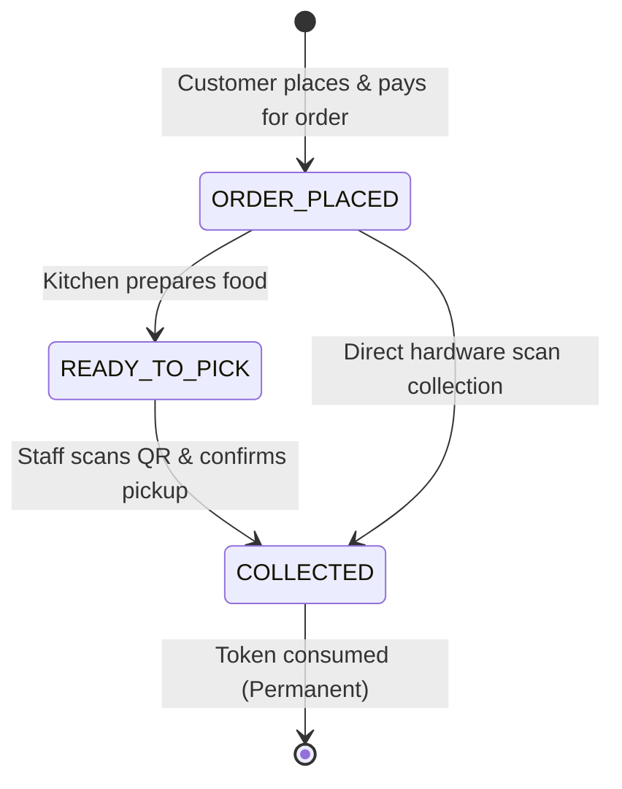

# Cafteria QR Order Verification & Bill Printing Architecture

> **Status:** Phase 5.1 Live  
> **Scope:** Cryptographic Pickup Passes, Optical Scanner, Hardware Kiosk & Thermal Receipts.

---

## 1. Subsystem Overview

Cafteria establishes cryptographic pickup verification and print-optimized billing for canteen meal dispatch:
1. **Opaque Verification Token**: Upon successful payment or Pay Later checkout, an unguessable token (`CAF-QR-XXXXXX`) is generated and securely bound to the order record.
2. **Customer Pass Screen**: Customer displays a high-resolution SVG QR code and alphanumeric token on their phone at the pickup counter.
3. **Staff Scanner & Dispatch (`admin/src/app/scan/page.tsx`)**: Canteen operators scan the QR pass via camera or enter the manual token code to inspect items and confirm collection.
4. **Hardware Kiosk & Auto-Printer (`admin/src/app/printer/page.tsx`)**: Dedicated hardware thermal printing interface for the `printer` role that auto-focuses scanner keystrokes, submits tokens directly via `/api/v1/admin/orders/collect-qr`, and triggers automatic ESC/POS printing.
5. **Printable Bills**: Print-optimized stylesheets (`@media print`) format full register receipts on 80mm POS thermal paper or standard sheets with zero margins.

---

## 2. Order Verification Lifecycle

### Verification Eligibility Rules:
An order is eligible for collection if and only if:
- `payment_status = 'paid'` (or approved Pay Later).
- `order_stage != 'COLLECTED'` (duplicate collections are rejected with `ALREADY_COLLECTED`).
- Time of scan is before 10:00 PM IST (UTC+05:30) of the order's service day (late scans rejected with `QR_EXPIRED`).

---

## 3. REST API Interface

### Admin Endpoints
- `POST /api/v1/admin/orders/verify-qr`:
  - Body: `{ qr_token: string }`.
  - Non-mutating pre-flight inspection returning order items, customer identity, stage, and eligibility status.
- `POST /api/v1/admin/orders/collect-qr`:
  - Body: `{ qr_token: string }`.
  - Direct atomic collection by QR token code, updating `order_stage = 'COLLECTED'`, `order_status = 'COLLECTED'`, `collected_at = now()`, and `qr_consumed_at = now()`.
- `POST /api/v1/admin/orders/:id/collect`:
  - Collects order by internal UUID.
- `GET /api/v1/admin/orders/:id/receipt`:
  - Returns itemized bill data snapshot for operations register.

### Customer Endpoints
- `GET /api/v1/orders/:id/receipt`:
  - Customer bill retrieval endpoint.

---

## 4. Print Layouts & Hardware POS Integration

Both customer and admin bill views implement CSS `@media print` rules:
- Interactive headers, footers, buttons, and navigation bars are hidden (`print:hidden`, `.no-print`).
- Receipts format cleanly for 80mm thermal receipt printers with zero margin clipping (`@page { margin: 8mm; }`).
